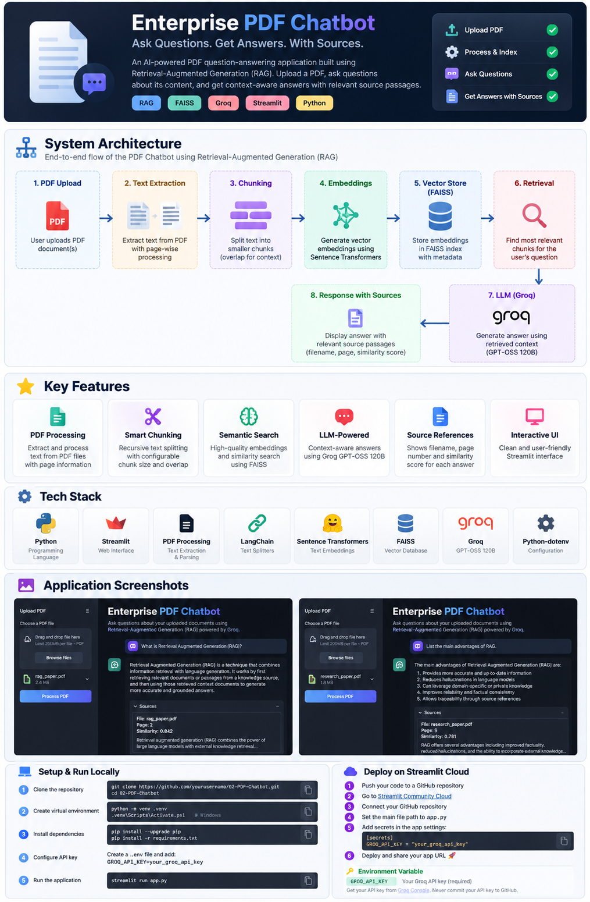

# 📄 Enterprise PDF Chatbot — RAG Powered by Groq

An AI-powered PDF question-answering application built using **Retrieval-Augmented Generation (RAG)**. Upload a PDF, ask questions about its content, and get context-aware answers with relevant source passages.

The project combines semantic search using **FAISS**, text embeddings using **Sentence Transformers**, and response generation using **Groq's GPT-OSS 120B model**.

## ✨ Features

- 📄 PDF text extraction and page-wise processing
- ✂️ Text chunking with configurable chunk size and overlap
- 🧠 Semantic embeddings using Sentence Transformers
- 🔎 Similarity search using FAISS
- 🤖 LLM-powered answers using Groq
- 📚 Source references with filename, page number, and similarity score
- 💬 Interactive chat interface built with Streamlit
- 🔐 API key configuration through environment variables


## 🏗️ System Architecture

The application follows a Retrieval-Augmented Generation (RAG) pipeline to retrieve relevant information from PDF documents and generate context-aware answers.



### Workflow

1. **PDF ingestion:** Extract text from uploaded PDF pages.
2. **Chunking:** Split text into manageable overlapping chunks.
3. **Embedding generation:** Convert chunks into numerical vectors.
4. **Vector indexing:** Store embeddings and metadata in FAISS.
5. **Retrieval:** Find the chunks most relevant to the user's question.
6. **Answer generation:** Send the question and retrieved context to Groq.
7. **Source references:** Display document name, page number, and similarity score.


## 🛠️ Tech Stack

| Component | Technology |
|---|---|
| Language | Python |
| User Interface | Streamlit |
| PDF Processing | Project PDF loader |
| Text Chunking | LangChain Text Splitters |
| Embeddings | Sentence Transformers |
| Vector Database | FAISS |
| LLM | Groq — GPT-OSS 120B |
| Configuration | python-dotenv |

## 📁 Project Structure

```text
02-PDF-Chatbot/
├── config/
├── core/
│   ├── pdf_loader.py
│   ├── utils.py
│   ├── chunker.py
│   ├── embedding.py
│   ├── vector_store.py
│   ├── groq_client.py
│   └── rag_pipeline.py
├── data/
│   ├── raw/
│   ├── processed/
│   └── chunks/
├── notebook/
├── screenshots/
├── vector_store/
│   ├── faiss_index.bin
│   └── metadata.json
├── app.py
├── ingest.py
├── chunk_documents.py
├── build_vector_store.py
├── search_demo.py
├── requirements.txt
├── .env.example
└── README.md
```

*Note: The structure above describes the intended project organization. Keep only files and directories that actually exist in your repository.*

## ⚙️ Getting Started

### 1. Clone the repository

```bash
git clone <YOUR_GITHUB_REPOSITORY_URL>
cd 02-PDF-Chatbot
```

### 2. Create a virtual environment

```bash
python -m venv .venv
```

Activate it on Windows:

```powershell
.venv\Scripts\Activate.ps1
```

### 3. Install dependencies

```bash
python -m pip install --upgrade pip
pip install -r requirements.txt
```

Use compatible versions of PyTorch, torchvision, FAISS, and other dependencies for your Python version.

### 4. Configure your Groq API key

Create a `.env` file in the project root:

```env
GROQ_API_KEY=your_groq_api_key
```

Obtain an API key from [Groq Console](https://console.groq.com/).

**Security:** Never commit `.env` or expose your API key in source code.

### 5. Add your PDF

Place your PDF file inside:

```text
data/raw/
```

### 6. Build the vector store

Run the scripts in order:

```bash
python ingest.py
python chunk_documents.py
python build_vector_store.py
```

This extracts PDF text, creates chunks, generates embeddings, and builds the FAISS index.

### 7. Launch the application

```bash
streamlit run app.py
```

Open the local URL displayed in your terminal.

## 💬 How to Use

1. Launch the Streamlit application.
2. Upload a PDF using the sidebar.
3. Click **Process PDF**, if shown in the application.
4. Wait for extraction, chunking, embedding generation, and indexing to finish.
5. Enter a question in the chat input.
6. Review the generated answer and its source passages.

## 🔍 How RAG Works

**Retrieval-Augmented Generation** combines information retrieval with language generation.

1. **Extraction:** Read text from the uploaded PDF.
2. **Chunking:** Divide text into smaller sections for retrieval.
3. **Embedding:** Convert chunks into numerical vectors.
4. **Indexing:** Store vectors in FAISS.
5. **Retrieval:** Find chunks most similar to the user's question.
6. **Generation:** Pass the question and retrieved context to the LLM.
7. **Sources:** Display retrieved document passages for reference.

## 🔐 Environment Variables

| Variable | Purpose |
|---|---|
| `GROQ_API_KEY` | Authenticates requests to the Groq API |

For deployment, configure secrets through the hosting platform rather than committing credentials.

## ☁️ Deployment

The application can be deployed on [Streamlit Community Cloud](https://share.streamlit.io/).

Before deployment:

- Ensure `requirements.txt` contains all required dependencies.
- Configure `GROQ_API_KEY` in the application's Secrets settings.
- Keep API keys, virtual environments, and private PDFs out of Git.
- Test PDF upload and indexing in the deployed environment.
- Account for temporary local storage and available memory when building the vector index.

## 🚀 Future Improvements

- Support multiple PDFs and document collections.
- Add document-level filtering and source citations.
- Improve error handling and upload validation.
- Add persistent vector storage where required.
- Support additional document formats.
- Add automated tests and deployment checks.

## ⚠️ Limitations

- Answer quality depends on the extracted text and retrieved context.
- Scanned PDFs may require OCR.
- Large documents can increase processing time and memory usage.
- LLM responses may be inaccurate; verify important information against the source PDF.
- Groq API availability, rate limits, and model access depend on the account and service configuration.

## 👨‍💻 Author

**Aditya Kumar Singh**

GitHub: [@connectwithaadi](https://github.com/connectwithaadi)

---

If you find this project useful, consider giving the repository a ⭐.

