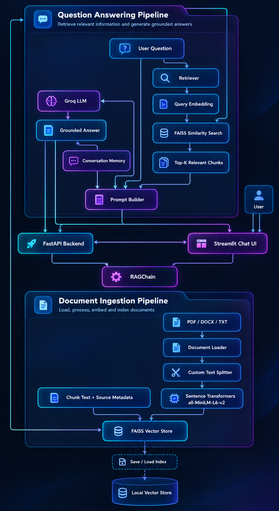
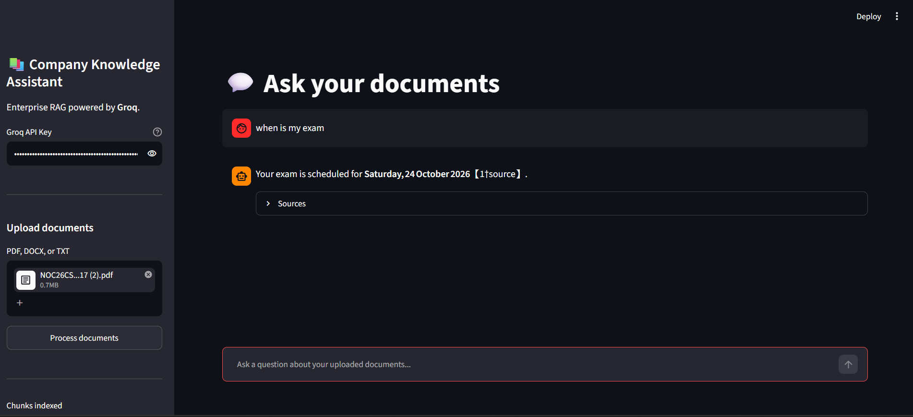

# 📚 Company Knowledge Assistant — Enterprise RAG System

An AI-powered document question-answering system built using **Retrieval-Augmented Generation (RAG)**. Upload PDF, DOCX, and TXT documents, ask questions in natural language, and receive context-aware answers generated using Groq with relevant source references.

## ✨ Features

- **Multi-format document support:** Upload PDF, DOCX, and TXT files.
- **Text chunking:** Split documents into manageable chunks with configurable overlap.
- **Semantic search:** Generate embeddings using Sentence Transformers and retrieve relevant content using FAISS.
- **LLM-powered answers:** Generate context-aware responses using Groq.
- **Source references:** Display document sources associated with retrieved context.
- **Conversation memory:** Maintain conversation history for follow-up questions.
- **Persistent vector store:** Save and reload the FAISS index.
- **Interactive interface:** Chat with uploaded documents through Streamlit.
- **REST API:** FastAPI backend for API-based access.
- **Docker support:** Dockerfile included for containerization.

## 🏗️ System Architecture

The application follows a modular RAG architecture with separate document ingestion and question-answering pipelines.



### 🔄 How It Works

1. **Document ingestion:** The user uploads documents through the Streamlit interface.
2. **Text extraction:** The document loader extracts text from supported file formats.
3. **Chunking:** The text splitter divides content into smaller, overlapping chunks.
4. **Embedding generation:** Sentence Transformers converts document chunks into numerical vectors.
5. **Vector indexing:** FAISS stores the vectors with associated chunk metadata.
6. **Semantic retrieval:** The retriever finds the most relevant chunks for the user's question.
7. **Prompt construction:** The prompt builder combines the question, retrieved context, and conversation history.
8. **Answer generation:** Groq generates a response using the supplied context.
9. **Response delivery:** The application displays the answer and available source references.

## 🖥️ Application Screenshot



*The Streamlit interface allows users to enter a Groq API key, upload documents, process them, and ask questions about their content.*

## 🛠️ Tech Stack

| Component | Technology |
|---|---|
| Programming language | Python |
| User interface | Streamlit |
| Backend API | FastAPI |
| Large language model | Groq API |
| Embeddings | Sentence Transformers |
| Vector database | FAISS |
| Document processing | PDF, DOCX, TXT loaders |
| Conversation memory | Custom Python module |
| Configuration | Environment variables |
| Containerization | Docker |

## 📁 Project Structure

```text
03-Knowledge Assistant/
├── api/
│   ├── __init__.py
│   └── main.py
├── docs/
│   └── screenshots/
│       └── Screenshot.png
├── notebooks/
│   └── KnowledgeAssistant.ipynb
├── src/
│   ├── __init__.py
│   ├── chat_memory.py
│   ├── embeddings.py
│   ├── loader.py
│   ├── prompt.py
│   ├── rag_chain.py
│   ├── retriever.py
│   ├── splitter.py
│   ├── utils.py
│   └── vectorstore.py
├── streamlit_app/
│   └── app.py
├── Dockerfile
├── app.py
├── requirements.txt
└── README.md
```

## ⚙️ Installation and Setup

### 1. Clone the repository

```bash
git clone https://github.com/connectwithaadi/RAG-Projects.git
cd RAG-Projects
cd "03-Knowledge Assistant"
```

### 2. Create a virtual environment

```bash
python -m venv .venv
```

Activate it on Windows:

```powershell
.venv\Scripts\activate
```

### 3. Install dependencies

```bash
python -m pip install --upgrade pip
pip install -r requirements.txt
```

### 4. Configure environment variables

Create a `.env` file in the project root:

```env
GROQ_API_KEY=your_groq_api_key
GROQ_MODEL=openai/gpt-oss-120b

CHUNK_SIZE=1000
CHUNK_OVERLAP=150
TOP_K=5
SCORE_THRESHOLD=0.0
MEMORY_LIMIT=10
VECTOR_STORE_DIR=data/vector_store
UPLOAD_DIR=data/uploaded_docs
```

Get your API key from the [Groq Console](https://console.groq.com/keys).

**Security:** Never commit your `.env` file or expose your API key in screenshots or source code. Add `.env` and `.venv/` to `.gitignore`.

### 5. Run the Streamlit application

From the project root:

```bash
streamlit run streamlit_app/app.py
```

Open the local URL displayed in the terminal, usually `http://localhost:8501`.

### 6. Use the application

1. Enter your Groq API key in the sidebar.
2. Upload one or more PDF, DOCX, or TXT documents.
3. Click **Process documents** to extract, chunk, embed, and index their content.
4. Ask a question about the uploaded documents.
5. Review the generated answer and expand **Sources** to inspect the associated document references.

## 🐳 Docker

A Dockerfile is included for containerizing the application.

Build the image:

```bash
docker build -t company-knowledge-assistant .
```

Run it:

```bash
docker run --env-file .env -p 8501:8501 company-knowledge-assistant
```

Ensure the Dockerfile starts the Streamlit application and that the necessary application files and dependencies are included in the image.

## 🔐 Configuration

The application supports environment-based configuration for the Groq API key, model name, chunk size, chunk overlap, retrieval count, score threshold, conversation memory limit, and storage directories.

Tune these settings according to your document sizes and retrieval requirements.

## 🚀 Future Improvements

- Add automated tests for document ingestion and retrieval.
- Improve page-level source citations and retrieved-text previews.
- Add support for more document formats.
- Implement authentication and access control.
- Deploy the application to a cloud hosting platform.
- Add streaming responses and document-level filtering.

## 👨‍💻 Author

**Aditya Kumar Singh**

GitHub: [@connectwithaadi](https://github.com/connectwithaadi)

---

*Built to explore Retrieval-Augmented Generation, semantic search, vector databases, and LLM-powered document question answering.*

